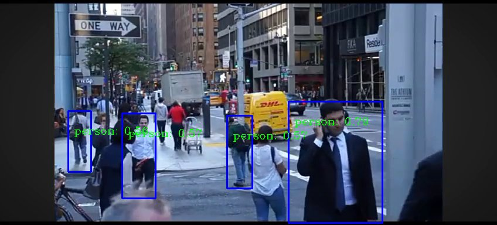
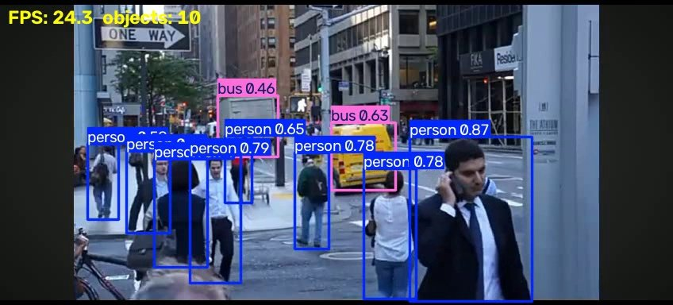
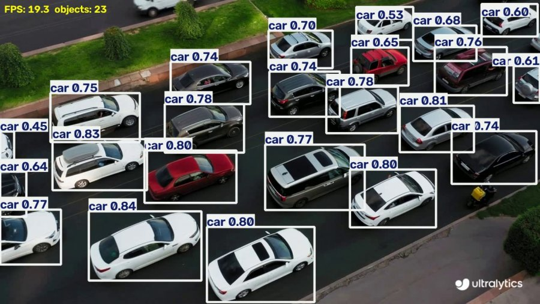
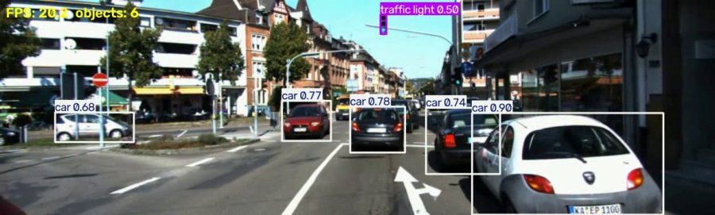
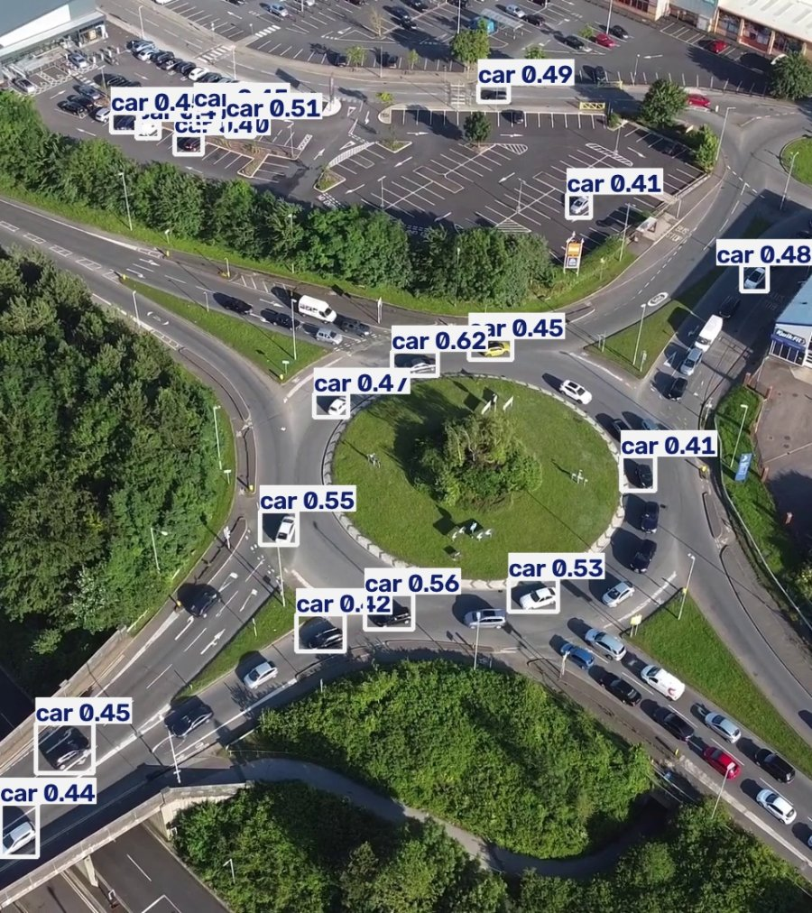
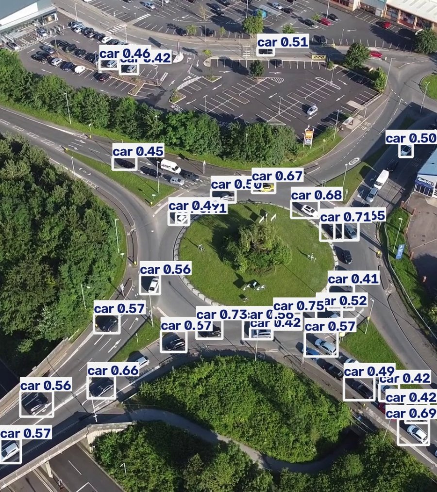
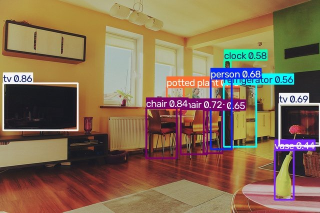

# Real-Time Object Detection with YOLO26n (CPU)


Detects 80 everyday object types (people, cars, buses, traffic lights, phones, chairs and more) in images, video files and a live webcam. It runs in real time on an ordinary laptop CPU; no GPU is needed.

The project started as a Google Colab notebook using **SSD MobileNet V3** through OpenCV's DNN module. It was rebuilt around **Ultralytics YOLO26n**, which finds far more objects and still runs in real time on a CPU.

<table>
  <tr>
    <th>Before: SSD MobileNet V3 (original notebook)</th>
    <th>After: YOLO26n (this project)</th>
  </tr>
  <tr>
    <td></td>
    <td></td>
  </tr>
  <tr>
    <td align="center">4 people detected</td>
    <td align="center">10 objects detected, at about 16 FPS on a laptop CPU</td>
  </tr>
</table>

## Features

- Works on single images, video files, whole folders, or a live webcam
- Real-time on a laptop CPU: 13–21 FPS on 720p and 1080p video
- Live preview window with boxes, labels, confidence scores and an FPS counter
- Saves annotated images and videos to `outputs/`
- Prints a summary for each video: speed, peak objects per frame, and average confidence per object type
- Downloads the model weights (5.3 MB) automatically on the first run

## Project structure

```
├── realtime_detect.py       # main script (YOLO26n)
├── requirements.txt
├── Real_Time_ObDe.ipynb     # original Colab notebook (SSD MobileNet V3), kept for comparison
├── bmw.jpeg, bmw2.jpg       # sample images
├── complex_scene.jpg        # cluttered indoor test image (COCO 2017 validation set)
├── BG2.mp4                  # sample street video
├── test_videos/             # harder test videos (sources in test_videos/SOURCES.txt)
├── docs/                    # images used in this README
├── models/                  # created on first run; yolo26n.pt is downloaded here
└── outputs/                 # created on first run; annotated results are saved here
```

## Installation

You need Python 3.10 or newer. The project was tested with Python 3.12.

```bash
git clone https://github.com/<your-username>/<repo-name>.git
cd <repo-name>
python -m venv .venv
```

Activate the virtual environment:

```bash
# Windows (PowerShell)
.venv\Scripts\Activate.ps1

# macOS / Linux
source .venv/bin/activate
```

Then install the dependencies (Ultralytics, PyTorch and OpenCV):

```bash
pip install -r requirements.txt
```

> **Notes**
> - On Linux, pip installs the larger GPU (CUDA) build of PyTorch by default. For a much smaller CPU-only install, first run `pip install torch torchvision --index-url https://download.pytorch.org/whl/cpu`.
> - If PowerShell blocks the activation script, skip activating and run Python from the environment directly, for example `.venv\Scripts\python.exe realtime_detect.py`.

## Usage

```bash
python realtime_detect.py                          # every image and video in the project folder
python realtime_detect.py --source bmw2.jpg        # one image
python realtime_detect.py --source BG2.mp4         # one video
python realtime_detect.py --source test_videos     # every image and video in a folder
python realtime_detect.py --source 0               # live webcam (use 1, 2... for other cameras)
```

**Controls:** in a video or webcam window, click the window and press `q` to stop. In an image window, press any key to move on.

| Option | What it does | Default |
|---|---|---|
| `--source` | Image, video, folder, or webcam number | the project folder |
| `--conf` | Minimum confidence for a box to be shown | `0.4` |
| `--imgsz` | Size the model works at. Smaller is faster; larger finds smaller objects. | `640` |
| `--no-show` | Don't open preview windows | |
| `--no-save` | Don't save annotated videos. Images are always saved. | |

Example output:

```
[video] dashboard_sample: 312 frames in 22.5s, average 13.9 FPS -> outputs\dashboard_sample_detected.mp4
        peak per frame: car x25, motorcycle x1, person x1
        avg per frame @ avg confidence: car 22.8 @ 0.72, person 0.1 @ 0.49, motorcycle 0.0 @ 0.42
```

## Results

All tests ran on an Intel Core Ultra 5 125H laptop CPU with 16 GB RAM and no GPU, using Python 3.12, Ultralytics 8.4 and PyTorch 2.14 (CPU build).

### Why YOLO26n

Published accuracy on the COCO benchmark (mAP 50–95; higher is better):

| Model | Year | COCO mAP | Notes |
|---|---|---|---|
| SSD MobileNet V3 Large (original notebook) | 2019 | 22.6 | Measured at 320×320 input |
| YOLOv5n | 2021 | 28.0 | |
| YOLOv8n | 2023 | 37.3 | |
| YOLO11n | 2024 | 39.5 | |
| **YOLO26n (this project)** | 2025 | **~40** | Optimised for CPUs and edge devices |
| RF-DETR Nano | 2025 | 48.4 | Transformer model; needs a GPU for real-time use |

These figures are as published by each model's authors on COCO val2017. The YOLO models are measured at 640×640.

YOLO26n is about **1.8× as accurate** as the original model, at a similar size, and still runs in real time on a CPU.

### Old model vs new model on the same inputs

| Test | SSD MobileNet V3 (notebook) | YOLO26n |
|---|---|---|
| `bmw2.jpg` | car, person | car (0.75), person (0.49) |
| Street video (`BG2.mp4`) | About 4 people per frame | Up to 12 people, plus cars, buses, handbags and a bicycle |
| Class names | Wrong for most classes after the first 11. The label file didn't match the model's class numbers, so a handbag (class 31) was shown as "skis". | Correct; the names are built into the model |
| Speed | Not measured (ran in Colab) | 16–17 FPS on a laptop CPU |
| Webcam | Not reachable from Colab | Works locally |

### Stress test on complex videos

<table>
  <tr>
    <th>Dense traffic (aerial view)</th>
    <th>City driving (KITTI dataset)</th>
  </tr>
  <tr>
    <td></td>
    <td></td>
  </tr>
</table>

For each video, I counted the objects in one middle frame by hand and compared that with what the model found:

| Video | Speed | Actually visible (hand count) | Model found | Wrong boxes |
|---|---|---|---|---|
| Dense traffic | 13.9 FPS | 25 cars + 1 scooter | 23 cars | 0 |
| City driving | 20.6 FPS | 6 nearby cars, about 5 distant vehicles, 2 traffic lights | 5 cars + 1 traffic light | 0 |
| Roundabout from a drone | 12.8 FPS | 100+ tiny cars | 16 cars | 0 |

These are hand counts on single frames. They give an indication, not an official benchmark score.

- **Very few wrong boxes.** None of the checked frames had a box on the wrong object.
- **Medium and large objects:** it finds about 85–90% of them, even when they're packed together.
- **Small or distant objects** are the weak point, which is expected for the smallest "nano" model.

### Input size against small objects

A larger `--imgsz` helps the model find small objects, at the cost of speed. These are results on one frame of the roundabout video:

| `--imgsz` | Cars found | Speed |
|---|---|---|
| 640 (default) | 18 | 14.7 FPS |
| 960 | 25 | 9.6 FPS |
| 1280 | 29 | 5.5 FPS |

<table>
  <tr>
    <th>--imgsz 640: 18 cars</th>
    <th>--imgsz 1280: 29 cars</th>
  </tr>
  <tr>
    <td></td>
    <td></td>
  </tr>
</table>

The reverse also works. On the street video, `--imgsz 320` raised the speed to about 22 FPS but found only 7 people instead of 12.

### Cluttered indoor scene



10 objects across 7 types: 2 TVs, 3 chairs, a person, a refrigerator, a clock, a potted plant and a vase. Small items, such as a windowsill plant and a vase on the TV stand, were missed.

## Known limitations and ideas

- **Small or distant objects are often missed.** Try `--imgsz 960` or `1280`. Better still, use [SAHI](https://github.com/obss/sahi) tiling, which runs detection on overlapping tiles of each frame.
- **Similar vehicle types get confused.** For example, a delivery van can be labelled "bus".
- **A larger model is more accurate.** Change `MODEL_PATH` in `realtime_detect.py` to `models/yolo26s.pt` for better accuracy at lower speed. The weights download automatically.
- **Intel CPUs can run faster.** Exporting the model to [OpenVINO](https://docs.ultralytics.com/integrations/openvino/), Intel's inference toolkit, should speed it up (not yet tried in this project).
- **Saved webcam recordings play faster than real life.** The file uses the camera's frame rate (about 30 FPS), but frames are processed at about 16 FPS.

## The original notebook

`Real_Time_ObDe.ipynb` is the first version of this project, written for Google Colab. It loads SSD MobileNet V3 Large from the TensorFlow Object Detection model zoo with `cv2.dnn_DetectionModel`, at a 320×320 input size.

To run it, you need `frozen_inference_graph.pb`, `ssd_mobilenet_v3_large_coco_2020_01_14.pbtxt` and `Labels.txt` in Google Drive. These files aren't included in this repository. To keep the file small, the video demo's output was trimmed to its first five annotated frames.

## Credits

- [Ultralytics YOLO](https://github.com/ultralytics/ultralytics) (YOLO26), licensed AGPL-3.0
- Test videos from the [Ultralytics sample assets](https://github.com/ultralytics/assets/releases/tag/v0.0.0). The city driving clip is from the [KITTI Vision Benchmark](https://www.cvlibs.net/datasets/kitti/) (CC BY-NC-SA 3.0). See `test_videos/SOURCES.txt`.
- `complex_scene.jpg` is image 000000000139 from the [COCO 2017](https://cocodataset.org/) validation set.
- SSD MobileNet V3 is from the [TensorFlow Object Detection API](https://github.com/tensorflow/models/tree/master/research/object_detection) model zoo.
